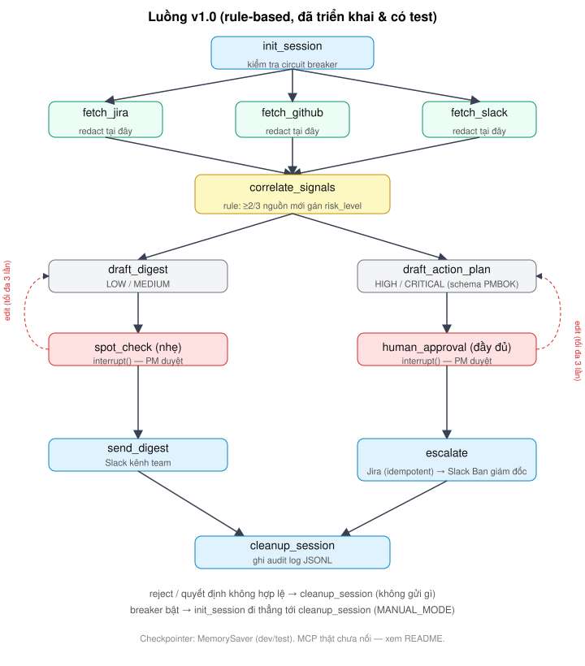

# Sprint Risk Monitoring Agent

> Agent giám sát rủi ro sprint từ 3 nguồn độc lập (Jira, GitHub, Slack): chỉ gán mức rủi ro khi **≥2/3 nguồn cùng xác nhận**, định tuyến theo mức độ, và **luôn dừng chờ PM duyệt** trước khi gửi bất cứ thứ gì ra ngoài.

`Python 3.11+` · `LangGraph` · `Pydantic` · `pytest` — Xây theo khung SOP cá nhân ([docs/SOP-AI-PM.md](./docs/SOP-AI-PM.md))
## Trạng thái (đọc trước)

| Hạng mục | Trạng thái |
|---|---|
| Luồng LangGraph, rule correlate, 2 tầng checkpoint, guardrail redact/grounding, schema PMBOK, circuit breaker, audit log, idempotency Jira | **Đã triển khai, 67 test pass** (chạy với client giả) |
| Kết nối MCP Jira / GitHub / Slack | **Chưa nối** — `mcp_clients/*_client.py` là điểm cắm, ném `NotImplementedError` |
| Drafter dùng Claude (`llm.py`) | Có code, **chưa kiểm thử với API thật** — mặc định dùng `TemplateDrafter` (không LLM) |
| Checkpointer | `MemorySaver` (dev/test, mất state khi restart) |
| Pilot trên sprint thật / số liệu đo | **Chưa thực hiện — chưa có số liệu** |
| P×I reference score, RAG, Postgres, tracing, Slack approval | **Chỉ là thiết kế** — [docs/roadmap-v2.md](./docs/roadmap-v2.md) |

Không có thành phần nào ở dưới đây được triển khai production.

## Chạy thử (dữ liệu synthetic)

```bash
pip install -e ".[dev]"
pytest -q                                      # 67 test
python scripts/run_weekly.py --demo            # CLI: agent dừng chờ bạn gõ approve / edit / reject
```

## Luồng v1.0



```
init_session ─► fetch_jira | fetch_github | fetch_slack (song song, redact ngay tại đây)
             ─► correlate_signals (rule, không LLM)
   LOW/MEDIUM  ─► draft_digest      ─► spot_check (nhẹ)      ─► send_digest ─► cleanup
   HIGH/CRIT   ─► draft_action_plan ─► human_approval (đầy đủ) ─► escalate    ─► cleanup
   edit → soạn lại (tối đa 3 lần) · reject / quyết định lạ → cleanup, không gửi gì
```

### Rule gán mức rủi ro (`nodes/correlate.py`, ngưỡng ở `config.py`)

| Số nguồn xác nhận 1 ticket | Điều kiện | Mức |
|---|---|---|
| 1 | — | bỏ qua (chỉ ghi vào `unconfirmed_tickets`) |
| 2 | còn > 5 ngày | LOW |
| 2 | còn lại | MEDIUM |
| 3 | — | HIGH |
| 3 | còn ≤ 1 ngày (kể cả quá hạn) | CRITICAL |

Tín hiệu: Jira (chưa xong, còn ≤ 2 ngày tới due) · GitHub (PR chờ review > 48h hoặc CI fail) · Slack (từ khóa blocked/stuck/waiting on/bị chặn/kẹt/đang chờ **và** có ticket_id khớp chính xác).

## Guardrail

- **Chống Severity Distortion:** `risk_level` do rule quyết định; LLM (nếu dùng) không được chấm mức.
- **Redact tại nguồn:** email, SĐT, thẻ (Luhn), token/secret (kể cả "mật khẩu:") bị che ngay ở fetch node, trước khi vào state hoặc prompt. Regex chỉ là baseline — môi trường thật nên dùng Presidio.
- **Chống bịa:** `validate_grounding` so mọi ticket_id trong bản nháp (và `evidence_refs`) với signals đã thu thập; cảnh báo luôn nằm trong payload checkpoint, kể cả khi rỗng.
- **Ranh giới Augmentation:** `RiskResponsePlan` có ≥2 phương án khác chiến lược (Avoid/Mitigate/Transfer/Accept), mỗi phương án có căn cứ và đánh đổi, **không có field "khuyến nghị"** (`extra="forbid"` từ chối nếu LLM tự thêm).
- **Human-in-the-loop không có đường tắt:** không có cờ tự duyệt; quyết định không hợp lệ = reject.
- **Vận hành an toàn (SOP 3.3 Bước 2):** giới hạn vòng edit; circuit breaker (2 lượt chạy liên tiếp có cảnh báo grounding → `MANUAL_MODE` tới khi PM `--reset-breaker`); Jira idempotent theo `sprint_id:ticket_id`; nguồn lỗi → chạy tiếp với cảnh báo "dữ liệu không đầy đủ".

Giới hạn đã biết: Slack gửi Ban giám đốc không hoàn tác được và không idempotent; regex ticket_id có thể báo nhầm với chuỗi dạng `CVE-2024-1`; Slack chỉ khớp chính xác ticket_id.

## Cấu trúc

```
src/sprint_risk_agent/   graph.py · state.py · schemas.py · guardrails.py · config.py · audit.py · runner.py · llm.py
  nodes/                 session · fetch · correlate · draft · checkpoints · actions
  mcp_clients/           base (Protocol) · fake (test/demo) · jira/github/slack (chưa nối)
tests/                   guardrails · schemas · correlate · graph flow
scripts/run_weekly.py    CLI demo duyệt tay
docs/                    SOP · design-notes · roadmap-v2 · case-study · rag-data-governance · diagrams/
```

## Kết quả đo được

*Chưa có.* Chỉ số dự kiến (planned, not yet measured): tỉ lệ báo động giả; % bản nháp bị edit/reject; thời gian chờ duyệt; số ticket Jira trùng; thời gian tiết kiệm so với baseline Time Audit của SOP.

## Tài liệu

- [SOP cá nhân — Ứng dụng AI vào quản lý dự án](./docs/SOP-AI-PM.md)
- [Ghi chú thiết kế](./docs/design-notes.md) · [Case study](./docs/case-study.md) · [Changelog quyết định](./CHANGELOG.md)
- [Roadmap v2.0 — thiết kế, chưa triển khai](./docs/roadmap-v2.md)
